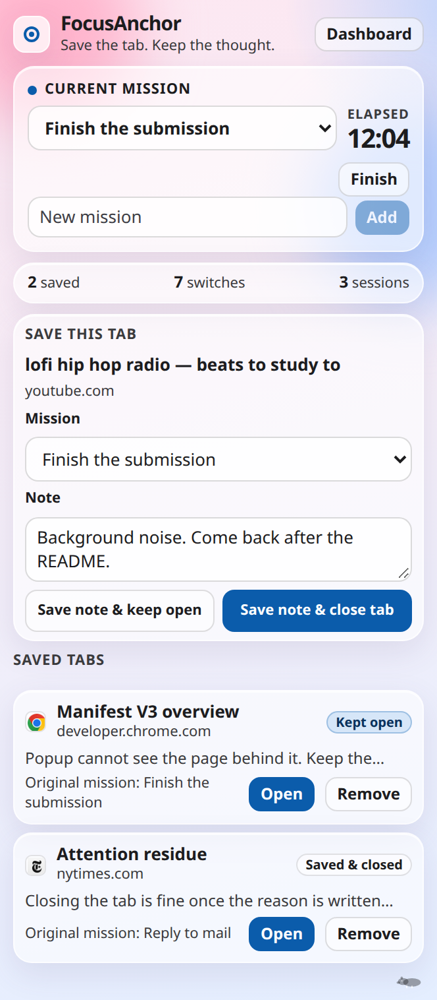

# FocusAnchor

You open a tab meaning to come back to it, then forget why it was open.

**FocusAnchor saves the thought with the tab.** Start a mission, write a note on a distracting page, keep that tab open or close it, and reopen it later with the note still attached.

It fits a productivity session: each mission keeps its own timer, and the tabs you parked stay recoverable without losing the reason they mattered.

FocusAnchor can also turn a page into a **Smart Anchor**: a short explanation of why it matters, a next action, a context note, and an optional question. On the dashboard, it can use the accepted anchors and saved notes to recommend where to restart a mission.

## Screenshots




The popup is a single glass panel, about 340 pixels wide. It scrolls when the saved-tab list or the open mission picker grows past the popup height.

## Install locally

Use a current version of Chrome and Node.js 22.22.2 or newer.

```sh
npm ci
npm run build
```

1. Open `chrome://extensions` and enable **Developer mode**.
2. Click **Load unpacked** and select this project's `dist` directory.
3. Pin **FocusAnchor**. After rebuilding, click **Reload** on its card in `chrome://extensions`.

## Configure hybrid AI

FocusAnchor uses the Firebase AI Logic Web SDK to prefer Chrome's on-device Prompt API and, only with explicit consent, fall back to the configured Gemini model in the cloud.

1. For on-device inference, use Chrome Desktop 139 or newer and enable `chrome://flags/#prompt-api-for-gemini-nano-multimodal-input`, then restart Chrome. The first request can take several minutes while Chrome downloads its model.
2. Copy `.env.example` to `.env.local`.
3. Create a Firebase Web app, enable Firebase AI Logic, and put its public Web configuration values in `.env.local`. Do not use service-account credentials.
4. For a local unpacked build, set `VITE_FIREBASE_APPCHECK_DEBUG=true`, rebuild, and reload the extension.
5. Open the full-page Dashboard, open its DevTools console, and make one consented Hybrid request. Firebase prints a per-install App Check debug token. Register that token for the Web app in the Firebase console, then retry the request.

Never commit the emitted App Check token. With `VITE_FIREBASE_APPCHECK_DEBUG=false`, cloud fallback stays locked unless the app is extended with a production App Check custom-token provider. Device Only and Hybrid mode both require the Firebase Web configuration because they run through the Firebase AI Logic SDK.

## Try it

1. Open two ordinary websites in the same window. Open FocusAnchor and start a mission, such as “Finish my hackathon submission.” Add another with **Add** if you are juggling more than one. The active mission’s timer counts every second as `m:ss`, and as `h:mm:ss` once an hour has passed. The mission menu switches which timer is active.
2. Switch to the other website. Open FocusAnchor, enter a note, and choose **Keep open** or **Save & close**. The note is saved on the active mission. Saving the same URL again updates its note.
3. To create a Smart Anchor, optionally paste a selected passage, choose **Device only** or the consent-gated Hybrid mode, and generate. Review the structured result before saving; nothing is stored automatically.
4. Open FocusAnchor again. Each saved tab shows its icon, title, note, and any accepted Smart Anchor. The **⋯** menu has the domain, status, AI context, **Open**, and **Remove**. **Open** brings the page back and shows a Chrome notification with the title and note.
5. If that tab is already gone, FocusAnchor asks you to open it again from the current page.
6. Open **Dashboard** for the full-page view. Saved tabs are grouped by mission. A restart brief recommends one real saved tab and a grounded next action. **Finish** ends that mission only and adds one to the completed-session count.

The switch count is how many times the active tab changed during the active mission, including changes caused by opening or closing tabs. Saved tabs is the number of unique URLs currently saved.

## Test

```sh
npm test
```

`npm test` builds the extension and exercises the AI privacy boundary, structured response validation, popup, and service worker with mocked providers and Chrome APIs. Loading the unpacked `dist` directory is what checks the real Chrome Prompt API, Firebase App Check, permissions, and tab behavior.

## Permissions and data

- `activeTab` lets the popup read the current tab's URL and title when opened from the toolbar. Saving supports HTTP and HTTPS pages.
- `tabs` lets FocusAnchor focus an already-open saved URL, close a tab you chose to close, and notice when a kept-open tab goes away.
- `storage` keeps the mission, dashboard counts, saved URLs, titles, notes, accepted Smart Anchors, actions, and original missions in this Chrome profile. There is no analytics.
- `notifications` shows the saved title and note when you open a saved tab.
- `favicon` shows each saved page's icon on its card.

FocusAnchor saves the record before it tries to close the tab. Reopening restores the URL, so unsaved form content or other page state may be lost when a tab closes.

Device Only blocks any result that is not reported as on-device. Hybrid mode requires a session-level consent checkbox and shows the exact field categories that may be sent before generation. A Smart Anchor can send the mission, page title, existing note, and user-pasted selected text; a restart brief can send the mission plus saved tab titles, notes, and accepted anchor fields. URLs, browsing history, and page contents that the user did not paste are not included in these prompts.

Built with React, TypeScript, Vite, and Firebase AI Logic for Manifest V3.
