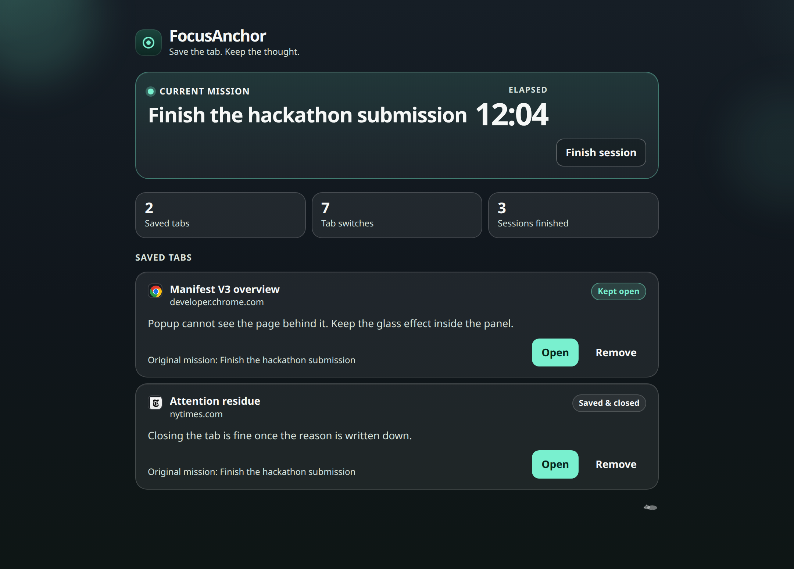

# FocusAnchor

You open a tab meaning to come back to it, then forget why it was open.

**FocusAnchor saves the thought with the tab.** Start a mission, write a note on a distracting page, keep that tab open or close it, and reopen it later with the note still attached.

It fits a productivity session: each mission keeps its own timer, and the tabs you parked stay recoverable without losing the reason they mattered.

## Screenshots




The popup screenshot shows the full layout. In Chrome the popup is about 600 pixels tall and the rest scrolls.

## Install locally

Use a current version of Chrome and Node.js 22.22.2 or newer.

```sh
npm ci
npm run build
```

1. Open `chrome://extensions` and enable **Developer mode**.
2. Click **Load unpacked** and select this project's `dist` directory.
3. Pin **FocusAnchor**. After rebuilding, click **Reload** on its card in `chrome://extensions`.

## Try it

1. Open two ordinary websites in the same window. Open FocusAnchor and start a mission, such as “Finish my hackathon submission.” Add another with **Add** if you are juggling more than one. The active mission’s timer counts every second as `m:ss`, and as `h:mm:ss` once an hour has passed. The mission menu switches which timer is active.
2. Switch to the other website. Open FocusAnchor, enter a note, choose the mission (it starts as the active one), and choose **Save note & keep open** or **Save note & close tab**. Saving the same URL again updates its note.
3. Open FocusAnchor again. Each saved tab is a card with its icon, title, domain, note, and whether it is still open. **Open** brings the page back and shows a Chrome notification with the title and note. Opening a closed tab marks it kept open. Closing a kept-open tab marks it closed. **Remove** deletes the saved entry.
4. If that tab is already gone, FocusAnchor asks you to open it again from the current page.
5. Open **Dashboard** for the full-page view. Saved tabs are grouped by mission. **Finish** ends that mission only and adds one to the completed-session count. An older single-mission save is kept as one mission in the list.

The switch count is how many times the active tab changed during the active mission, including changes caused by opening or closing tabs. Saved tabs is the number of unique URLs currently saved.

## Test

```sh
npm test
```

`npm test` builds the extension and exercises the popup and service worker with mocked Chrome APIs. Loading the unpacked `dist` directory is what checks real Chrome permissions and tab behavior.

## Permissions and data

- `activeTab` lets the popup read the current tab's URL and title when opened from the toolbar. Saving supports HTTP and HTTPS pages.
- `tabs` lets FocusAnchor focus an already-open saved URL, close a tab you chose to close, and notice when a kept-open tab goes away.
- `storage` keeps the mission, dashboard counts, and saved URLs, titles, notes, actions, and original missions in this Chrome profile. There is no server or analytics.
- `notifications` shows the saved title and note when you open a saved tab.
- `favicon` shows each saved page's icon on its card.

FocusAnchor saves the record before it tries to close the tab. Reopening restores the URL, so unsaved form content or other page state may be lost when a tab closes.

Built with React, TypeScript, and Vite for Manifest V3.
